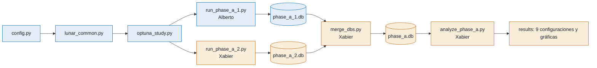
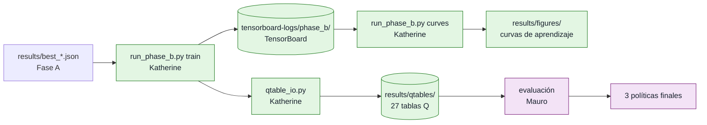

# Estado del equipo - Actividad 1 RL
Última actualización: 2026-10-26 por Alberto

## Equipo
- Fase A: Alberto (A.1), Xabier (A.2)
- Fase B: Katherine (B.1), Mauro (B.2)

## Qué pide la actividad en la Fase A
Entrega: 3/11/2026 (extensión 9/11) · Valor total de la actividad: 15 %.
La Fase A vale un 5 %: selección y justificación de los presupuestos de discretización, metodología con Optuna,
calidad de los experimentos y análisis de los resultados.

| Requisito del enunciado (sección 2, Fase A) | Cómo lo cumplimos | Quién |
|---|---|---|
| 1. Tres presupuestos de discretización con tamaños claramente distintos | 3 / 5 / 7 bins por dimensión → 6.561 / 390.625 / 5.764.801 estados (`config.py`) | Alberto |
| 2. Scripts de Optuna similares a `experiment_2.10.py` para SARSA, Expected SARSA y Q-Learning con cada presupuesto (9 combinaciones) | `optuna_study.py` (un estudio por algoritmo y presupuesto) y `lunar_common.py` | Alberto |
| 3. Al menos 180 combinaciones (20 por algoritmo y presupuesto) con el mismo presupuesto de entrenamiento | 30 trials × 9 estudios = 270, todos con 500.000 pasos | Alberto (5 estudios) y Xabier (4 estudios) |
| 4. Mejor combinación por algoritmo y presupuesto → 9 configuraciones | `analyze_phase_a.py` extrae la mejor de cada estudio | Xabier |
| 5. Analizar cómo afecta el presupuesto de discretización a cada algoritmo | Sección de análisis del informe | Alberto (SARSA y Q-Learning), Xabier (Expected SARSA y comparación global) |

### Qué se entrega de la Fase A (sección 6 del enunciado)
- [x] Base de datos de Optuna: `optuna/phase_a.db` (fusión de las dos; la hace `merge_dbs.py`)
- [ ] Scripts de Python utilizados
- [ ] Informe en PDF con las secciones de la Fase A:

| Sección del informe | Contenido | Quién |
|---|---|---|
| 2 Entorno seleccionado | Descripción y justificación de LunarLander | Alberto |
| 3a Tamaños de discretización | Los tres niveles, tamaño de los espacios y justificación | Alberto |
| 3b Hiperparámetros | Tabla de hiperparámetros explorados y rangos | Xabier |
| 3c Resultados de Optuna | 3–5 gráficas más relevantes con su interpretación | Alberto y Xabier (cada uno las de sus estudios) |
| 3d Mejores configuraciones | Tabla con las nueve configuraciones | Xabier (tabla de las 9) y Alberto (sus 5 filas) |
| 5 Contribuciones individuales | 1–2 párrafos por persona | Cada uno el suyo |

## Los 9 estudios
Un **estudio** es una búsqueda de hiperparámetros con Optuna para **un algoritmo con un presupuesto de discretización**.
Cada estudio hace 30 trials: cada trial entrena un agente 500.000 pasos con unos hiperparámetros distintos y lo evalúa
en 50 episodios. Al terminar, Optuna se queda con la mejor combinación: esa es una de las **9 configuraciones** de la actividad.
Los estudios son independientes entre sí, así que se pueden hacer a la vez.

Estado: ⬜ pendiente · 🟨 en curso · ✅ hecho

| Algoritmo | low (3 bins, 6.561 estados) | medium (5 bins, 390.625) | high (7 bins, 5.764.801) |
|---|---|---|---|
| SARSA | A.1 ✅ | A.1 ✅ | A.1 ✅ |
| Expected SARSA | A.2 ✅ | A.2 ✅ | A.2 ✅ |
| Q-Learning | A.1 ✅ | A.1 ✅ | A.2 ✅ |

### A.1 Alberto: 5 estudios (150 trials) → `optuna/phase_a_1.db`
- SARSA con los tres presupuestos y Q-Learning con low y medium.
- Se lanzan con `python run_phase_a_1.py` (≈ 35 min).

| Estudio | Mejor reward |
|---|---|
| sarsa_low | 9,99 |
| sarsa_medium | 130,74 |
| sarsa_high | 112,29 |
| qlearning_low | 10,87 |
| qlearning_medium | 148,55 |

### A.2 Xabier: 4 estudios (120 trials) → `optuna/phase_a_2.db`
- Expected SARSA con los tres presupuestos y Q-Learning con high.
- Se lanzan con `python run_phase_a_2.py` (≈ 30 min): copia de `run_phase_a_1.py` con `OWNER = "2"` y su lista de estudios.

| Estudio | Mejor reward |
|---|---|
| esarsa_low | 18,13 |
| esarsa_medium | 132,41 |
| esarsa_high | 126,78 |
| qlearning_high | 96,48 |

- Hay 9 estudios y 2 personas, así que no se divide exacto: Alberto hace 5 y Xabier 4. Xabier lo compensa escribiendo
  `merge_dbs.py` y `analyze_phase_a.py`.
- Los dos usan los mismos archivos (`config.py`, `lunar_common.py`, `optuna_study.py`) con los mismos valores.
  Solo cambia qué estudios lanza cada uno y en qué base de datos los guarda.
- Después se intercambian las bases de datos y se fusionan en `phase_a.db` (9 estudios, 270 trials).

## Tareas
### Entre los dos
- [ ] Revisar y aceptar `config.py` (bins, límites, rangos, pasos, semilla)
- [x] Repartir los 9 estudios
- [ ] Decidir si se amplía el rango de `learning_rate` (en pruebas llegó a 0,46 de un máximo de 0,5)
- [ ] Comprobar los límites de observación con datos medidos (percentiles 1 y 99)
- [ ] Intercambiar las bases de datos y fusionar las ramas
- [ ] Revisión cruzada del código y del texto

### A.1 Alberto
- [x] `config.py`
- [x] `lunar_common.py` (probado)
- [x] `optuna_study.py` (probado con 2 trials)
- [x] `run_phase_a_1.py`
- [x] `requirements.txt`, `.gitignore`, `README.md`, este archivo (en curso)
- [x] Ejecutar sus 5 estudios (≈ 35 min)
- [ ] Informe: 2 Entorno y 3a Discretización
- [ ] Informe: 3c y 3d de sus estudios
- [ ] Análisis: discretización en SARSA y Q-Learning
- [ ] Contribución individual

### A.2 Xabier
- [x] Instalar el entorno y comprobar con `python lunar_common.py`
- [x] `run_phase_a_2.py` (copia del de Alberto con `OWNER = "2"`)
- [x] Ejecutar sus 4 estudios (≈ 30 min)
- [x] `merge_dbs.py` (une las dos bases en `phase_a.db`)
- [x] `analyze_phase_a.py` (tabla de las 9 configuraciones y gráficas)
- [ ] Informe: 3b Hiperparámetros
- [ ] Informe: 3c y 3d de sus estudios y tabla de las 9
- [ ] Análisis: Expected SARSA y comparación global
- [ ] Contribución individual

## Cómo se conectan los archivos

Azul: Alberto · Ámbar: Xabier

## Entorno
- Gymnasium versión: 1.3.0   Entorno: LunarLander-v3
- Parámetros del entorno: continuous=False, gravity=-10.0, enable_wind=False
- Pasos/segundo medidos: ≈ 36.000 (≈ 14 s por trial de 500.000 pasos, MacBook de Alberto)
- Pasos/segundo medidos ≈ 16.000 (≈ 28 s por trial de 500.000 pasos, Windows de Xabier)

## Discretización
Límites de observación (los mismos en los tres niveles), en orden x, y, vx, vy, ángulo, vel. angular, pata1, pata2:
- low (mínimos): [-1.2, -0.1, -1.5, -1.5, -1.0, -1.5, 0.0, 0.0]
- high (máximos): [1.2, 1.5, 1.5, 1.5, 1.0, 1.5, 1.0, 1.0]

| Nivel | n_bins | n_estados | Acciones | Memoria tabla Q |
|---|---|---|---|---|
| low | 3 | 6.561 | 4 | ≈ 0,2 MB |
| medium | 5 | 390.625 | 4 | ≈ 12,5 MB |
| high | 7 | 5.764.801 | 4 | ≈ 184 MB |

Justificación:
- Bins 3/5/7: ≈ 60× más estados en cada nivel. Con 8 bins serían 16,7 M estados (≈ 540 MB de tabla Q).
- Límites ajustados a los rangos típicos de LunarLander; los de Gymnasium por defecto (±10 en velocidades) dejaban casi todos los bins vacíos. Pendiente de comprobar con datos medidos.

## Optuna
- Pasos por trial: 500.000   Episodios de evaluación: 50   Semilla: 47   Trials por estudio: 30
- Justificación: 30 trials (mínimo 20; TPE usa 10 aleatorios iniciales, quedan 20 guiados) · 500.000 pasos (≈ 14 s por trial; los 9 estudios ≈ 1 h) · 50 episodios (igual que la evaluación final de la actividad) · semilla 47 (la de experiment_2.10.py).
- Hiperparámetros: learning rate, decaimiento del lr, episodios de decaimiento, factor de descuento y epsilon (rangos en `SEARCH_SPACE` de `config.py`).

## 9 configuraciones elegidas
| Algoritmo | Presupuesto | n_bins | Estados | Mejor reward | Pasos eval. | learning_rate | lr_decay | lr_episodes_decay | discount_rate | epsilon |
|---|---|---|---|---|---|---|---|---|---|---|
| SARSA | low | 3 | 6.561 | 9.99 | 165 | 0.0328 | 1.00 | 500 | 0.93 | 0.05 |
| SARSA | medium | 5 | 390.625 | 130.74 | 304 | 0.1023 | 0.88 | 1000 | 0.95 | 0.00 |
| SARSA | high | 7 | 5.764.801 | 112.29 | 379 | 0.4640 | 1.00 | 1000 | 0.97 | 0.00 |
| Expected SARSA | low | 3 | 6.561 | 18.13 | 166 | 0.1164 | 0.88 | 100 | 0.96 | 0.05 |
| Expected SARSA | medium | 5 | 390.625 | 132.41 | 307 | 0.0725 | 0.82 | 500 | 0.93 | 0.00 |
| Expected SARSA | high | 7 | 5.764.801 | 126.78 | 365 | 0.2179 | 0.92 | 100 | 0.93 | 0.00 |
| Q-Learning | low | 3 | 6.561 | 10.87 | 161 | 0.2053 | 0.94 | 100 | 0.95 | 0.15 |
| Q-Learning | medium | 5 | 390.625 | 148.55 | 317 | 0.0805 | 0.98 | 100 | 0.96 | 0.00 |
| Q-Learning | high | 7 | 5.764.801 | 96.48 | 375 | 0.4555 | 0.92 | 100 | 0.95 | 0.00 |

## Qué pide la actividad en la Fase B
La Fase B vale un 5 %: rigor de los experimentos con múltiples semillas, interpretación de las curvas de aprendizaje,
análisis comparativo del rendimiento, la estabilidad y la convergencia, así como las conclusiones obtenidas.

| Requisito del enunciado (sección 3, Fase B) | Cómo lo cumplimos | Quién |
|---|---|---|
| 1. Mecanismo básico para guardar/cargar la tabla Q | `qtable_io.py` (`save_qtable`/`load_qtable`, guarda `.npy` + `.json` con metadatos) | Katherine |
| 2. Entrenamientos largos de las 9 configuraciones, 3 semillas por configuración (27 en total), mismo presupuesto máximo de pasos, registrados en TensorBoard | `run_phase_b.py train` (reutiliza `lunar_common.make_env`/`ALGO_CLASSES`; TensorBoard activado, a diferencia de la Fase A) | Katherine |
| 3. Guardar cada tabla Q con su algoritmo y discretización; evaluarla 50 episodios y elegir la mejor por presupuesto de discretización (3 políticas finales) | Evaluación de las 27 tablas Q guardadas (`qtable_io.load_qtable` + `deustorl.common.evaluate_policy`) | Mauro |
| 4. Inspección visual del comportamiento de las 3 políticas finales | Ejecución de las políticas finales con render del entorno | Mauro |
| 5. Analizar velocidad de aprendizaje, estabilidad y convergencia | A partir de las curvas de `run_phase_b.py curves` (media ± desviación estándar entre semillas) | Katherine |
| 5. Analizar rendimiento final e influencia de la discretización | A partir de las tablas comparativas de evaluación | Mauro |

### Qué se entrega de la Fase B (sección 6 del enunciado)
- [x] Registros de TensorBoard de los entrenamientos largos (`tensorboard-logs/phase_b/`, versionado en git)
- [ ] Tres políticas finales tras los entrenamientos largos (`results/qtables/`, una por presupuesto de discretización)
- [ ] Informe en PDF con las secciones de la Fase B:

| Sección del informe | Contenido | Quién |
|---|---|---|
| 4a Código de serialización | Funciones Python para guardar y cargar la tabla Q | Katherine |
| 4b Curvas de aprendizaje | Gráficas de TensorBoard (media y dispersión de semillas) y su interpretación | Katherine |
| 4c Políticas finales | Tabla comparativa de evaluación y descripción del comportamiento observado | Mauro |
| 4d Análisis comparativo | Velocidad de aprendizaje y estabilidad/convergencia (Katherine); rendimiento final e influencia de la discretización (Mauro) | Katherine y Mauro |
| 5 Contribuciones individuales | 1–2 párrafos por persona | Cada uno el suyo |

## Los 27 entrenamientos
Un **entrenamiento largo** es una ejecución completa de `learn()` para una de las 9 configuraciones seleccionadas en
la Fase A, con una semilla concreta (`PHASE_B_SEEDS` en `config.py`, por defecto `[0, 1, 2]`). Se hacen 3 semillas por
configuración (27 en total) para medir la estabilidad entre ejecuciones independientes, todas con el mismo presupuesto
máximo de pasos (`PHASE_B_TRAIN_STEPS`). Cada entrenamiento guarda su tabla Q (`qtable_io.py`) y queda registrado en
TensorBoard bajo `tensorboard-logs/phase_b/<algo>_<budget>_seed<semilla>_<fecha>` (carpeta versionada en git, para no tener que repetir los 27 entrenamientos).

Estado: ⬜ pendiente · 🟨 en curso · ✅ hecho

| Algoritmo | low (3 semillas) | medium (3 semillas) | high (3 semillas) |
|---|---|---|---|
| SARSA | ✅ | ✅ | ✅ |
| Expected SARSA | ✅ | ✅ | ✅ |
| Q-Learning | ✅ | ✅ | ✅ |

Los 27 entrenamientos se ejecutaron con `PHASE_B_TRAIN_STEPS = 2_000_000` y `PHASE_B_SEEDS = [0, 1, 2]`. Tablas Q en
`results/qtables/` (27 archivos), logs en `tensorboard-logs/phase_b/` y curvas en `results/figures/` (9 PNG, una por configuración).

### B.1 Katherine: entrenamientos, guardado y curvas
- Implementa y ejecuta `run_phase_b.py train` (27 entrenamientos) y `run_phase_b.py curves`. ✅ Completado.
- `qtable_io.py` es el formato común: Mauro carga desde ahí las tablas que ella guarda.

### B.2 Mauro: evaluación y políticas finales
- Carga las tablas Q guardadas por Katherine con `qtable_io.load_qtable` y las evalúa (50 episodios cada una).
- Mientras Katherine no tenga las 27 tablas finales, puede desarrollar su script de evaluación con una tabla
  provisional (por ejemplo, una guardada en una prueba pequeña).

## Tareas Fase B
### Entre los dos
- [x] Acordar el formato de los archivos de tabla Q y sus metadatos (algoritmo, discretización, semilla, configuración) → `qtable_io.py`
- [x] `PHASE_B_TRAIN_STEPS` en `config.py`: 2.000.000 de pasos, usado en los 27 entrenamientos reales
- [x] `PHASE_B_SEEDS` en `config.py`: `[0, 1, 2]`, usado en los 27 entrenamientos reales
- [ ] Revisión cruzada del código y del texto

### B.1 Katherine
- [x] `qtable_io.py` (probado)
- [x] `run_phase_b.py train` (probado con una configuración y pocos pasos)
- [x] `run_phase_b.py curves` (probado)
- [x] Ejecutar los 27 entrenamientos reales (`results/qtables/`, `tensorboard-logs/phase_b/`, `results/figures/`)
- [ ] Informe: 4a Código de serialización
- [ ] Informe: 4b Curvas de aprendizaje
- [ ] Análisis: velocidad de aprendizaje, estabilidad y convergencia
- [ ] Contribución individual

### B.2 Mauro
- [ ] Script de evaluación de las tablas Q guardadas
- [ ] Evaluar las 27 tablas Q (50 episodios cada una)
- [ ] Seleccionar las 3 políticas finales (una por presupuesto de discretización)
- [ ] Inspección visual de las 3 políticas finales
- [ ] Tablas comparativas de evaluación
- [ ] Informe: 4c Políticas finales
- [ ] Informe: 4d Análisis comparativo (rendimiento final e influencia de la discretización)
- [ ] Contribución individual

## Cómo se conectan los archivos de la Fase B

Verde: Katherine · Lila: Mauro
