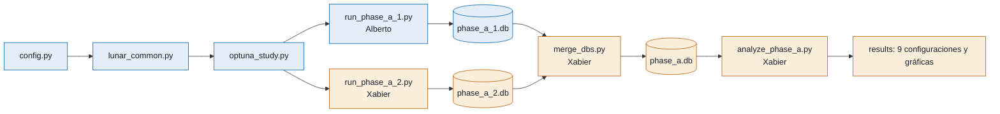

# Estado del equipo - Actividad 1 RL
Última actualización: 2026-10-26 por Alberto

## Equipo
- Fase A: Alberto (A.1), Xabier (A.2)

## Qué pide la actividad en la Fase A
Entrega: 3/11/2026 (extensión 9/11) · Valor total de la actividad: 15 %.
La Fase A vale un 5 %: selección y justificación de los presupuestos de discretización, metodología con Optuna,
calidad de los experimentos y análisis de los resultados.

| Requisito del enunciado (sección 2, Fase A) | Cómo lo cumplimos | Quién |
|---|---|---|
| 1. Tres presupuestos de discretización con tamaños claramente distintos | 3 / 5 / 7 bins por dimensión → 6.561 / 390.625 / 5.764.801 estados (`config.py`) | Alberto |
| 2. Scripts de Optuna similares a `experiment_2.10.py` para SARSA, Expected SARSA y Q-Learning con cada presupuesto (9 combinaciones) | `optuna_study.py` (un estudio por algoritmo y presupuesto) y `lunar_common.py` | Alberto |
| 3. Al menos 180 combinaciones (20 por algoritmo y presupuesto) con el mismo presupuesto de entrenamiento | 30 trials × 9 estudios = 270, todos con 500.000 pasos | Alberto (5 estudios) y Xabier (4 estudios) |
| 4. Mejor combinación por algoritmo y presupuesto → 9 configuraciones | `analyze_phase_a.py` extrae la mejor de cada estudio | Xabier |
| 5. Analizar cómo afecta el presupuesto de discretización a cada algoritmo | Sección de análisis del informe | Alberto (SARSA y Q-Learning), Xabier (Expected SARSA y comparación global) |

### Qué se entrega de la Fase A (sección 6 del enunciado)
- [ ] Base de datos de Optuna: `optuna/phase_a.db` (fusión de las dos; la hace `merge_dbs.py`)
- [ ] Scripts de Python utilizados
- [ ] Informe en PDF con las secciones de la Fase A:

| Sección del informe | Contenido | Quién |
|---|---|---|
| 2 Entorno seleccionado | Descripción y justificación de LunarLander | Alberto |
| 3a Tamaños de discretización | Los tres niveles, tamaño de los espacios y justificación | Alberto |
| 3b Hiperparámetros | Tabla de hiperparámetros explorados y rangos | Xabier |
| 3c Resultados de Optuna | 3–5 gráficas más relevantes con su interpretación | Alberto y Xabier (cada uno las de sus estudios) |
| 3d Mejores configuraciones | Tabla con las nueve configuraciones | Xabier (tabla de las 9) y Alberto (sus 5 filas) |
| 5 Contribuciones individuales | 1–2 párrafos por persona | Cada uno el suyo |

## Los 9 estudios
Cada estudio: 30 trials de 500.000 pasos. Estado: ⬜ pendiente · 🟨 en curso · ✅ hecho

| Algoritmo | low (3 bins, 6.561 estados) | medium (5 bins, 390.625) | high (7 bins, 5.764.801) |
|---|---|---|---|
| SARSA | A.1 ⬜ | A.1 ⬜ | A.1 ⬜ |
| Expected SARSA | A.2 ⬜ | A.2 ⬜ | A.2 ⬜ |
| Q-Learning | A.1 ⬜ | A.1 ⬜ | A.2 ⬜ |

Bases de datos: `optuna/phase_a_1.db` (Alberto) y `optuna/phase_a_2.db` (Xabier).

## Tareas
### Entre los dos
- [ ] Revisar y aceptar `config.py` (bins, límites, rangos, pasos, semilla)
- [x] Repartir los 9 estudios
- [ ] Confirmar con el profesor que un grupo de dos es válido (el enunciado dice 3-4)
- [ ] Decidir si se amplía el rango de `learning_rate` (en pruebas llegó a 0,46 de un máximo de 0,5)
- [ ] Comprobar los límites de observación con datos medidos (percentiles 1 y 99)
- [ ] Intercambiar las bases de datos y fusionar las ramas
- [ ] Revisión cruzada del código y del texto

### A.1 Alberto
- [x] `config.py`
- [x] `lunar_common.py` (probado)
- [x] `optuna_study.py` (probado con 2 trials)
- [x] `run_phase_a_1.py`
- [ ] `requirements.txt`, `.gitignore`, `README.md`, este archivo (en curso)
- [ ] Ejecutar sus 5 estudios (≈ 35 min)
- [ ] Informe: 2 Entorno y 3a Discretización
- [ ] Informe: 3c y 3d de sus estudios
- [ ] Análisis: discretización en SARSA y Q-Learning
- [ ] Contribución individual

### A.2 Xabier
- [ ] Instalar el entorno y comprobar con `python lunar_common.py`
- [ ] `run_phase_a_2.py` (copia del de Alberto con `OWNER = "2"`)
- [ ] Ejecutar sus 4 estudios (≈ 30 min)
- [ ] `merge_dbs.py` (une las dos bases en `phase_a.db`)
- [ ] `analyze_phase_a.py` (tabla de las 9 configuraciones y gráficas)
- [ ] Informe: 3b Hiperparámetros
- [ ] Informe: 3c y 3d de sus estudios y tabla de las 9
- [ ] Análisis: Expected SARSA y comparación global
- [ ] Contribución individual

## Cómo se conectan los archivos

Azul: Alberto · Ámbar: Xabier

## Entorno
- Gymnasium versión: 1.3.0   Entorno: LunarLander-v3
- Parámetros del entorno: continuous=False, gravity=-10.0, enable_wind=False
- Pasos/segundo medidos: ≈ 36.000 (≈ 14 s por trial de 500.000 pasos, MacBook de Alberto)

## Discretización
Límites de observación (los mismos en los tres niveles), en orden x, y, vx, vy, ángulo, vel. angular, pata1, pata2:
- low (mínimos): [-1.2, -0.1, -1.5, -1.5, -1.0, -1.5, 0.0, 0.0]
- high (máximos): [1.2, 1.5, 1.5, 1.5, 1.0, 1.5, 1.0, 1.0]

| Nivel | n_bins | n_estados | Acciones | Memoria tabla Q |
|---|---|---|---|---|
| low | 3 | 6.561 | 4 | ≈ 0,2 MB |
| medium | 5 | 390.625 | 4 | ≈ 12,5 MB |
| high | 7 | 5.764.801 | 4 | ≈ 184 MB |

Justificación:
- Bins 3/5/7: ≈ 60× más estados en cada nivel. Con 8 bins serían 16,7 M estados (≈ 540 MB de tabla Q).
- Límites ajustados a los rangos típicos de LunarLander; los de Gymnasium por defecto (±10 en velocidades) dejaban casi todos los bins vacíos. Pendiente de comprobar con datos medidos.

## Optuna
- Pasos por trial: 500.000   Episodios de evaluación: 50   Semilla: 47   Trials por estudio: 30
- Justificación: 30 trials (mínimo 20; TPE usa 10 aleatorios iniciales, quedan 20 guiados) · 500.000 pasos (≈ 14 s por trial; los 9 estudios ≈ 1 h) · 50 episodios (igual que la evaluación final de la actividad) · semilla 47 (la de experiment_2.10.py).
- Hiperparámetros: learning rate, decaimiento del lr, episodios de decaimiento, factor de descuento y epsilon (rangos en `SEARCH_SPACE` de `config.py`).

## 9 configuraciones elegidas
(pegar tabla de results/best_configs.md cuando estén los 9 estudios)
